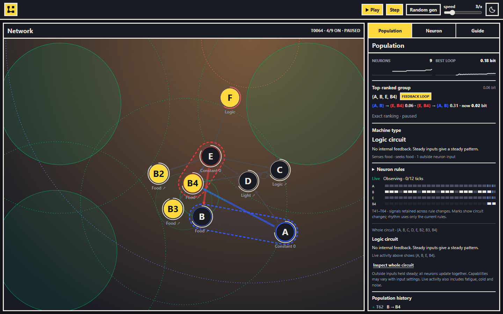

# Logocausal

A live ecology of Boolean neurons that fire, feed, move, divide, rewire, and form feedback loops, packaged as a web component.

[Open the app](https://jjjpanda.github.io/logocausal/) · [Embed view](https://jjjpanda.github.io/logocausal/embed/)



## Neurons

Each neuron is a small logic gate with a body. It reads up to three other neurons, computes its truth table (NOT, AND, OR, XOR, …), and spends energy to live. Neurons that find food divide; neurons that starve die. Nothing restores a lost population.

| Part | Behavior |
| --- | --- |
| Gate | Computes the next on/off signal from the neurons it reads. Three firings in a row force a rest. |
| Sensor | ORs in the world at its position: light (near the sun) or food (within smell range). |
| Motor | Pushes its own body toward food or a comfortable light band. Links pull neighbors along. |
| Energy | Food feeds the neurons in a patch; firing, links, roles, heat and crowding cost energy. Linked neurons share from rich to poor. |
| Division | A neuron at 2.2 energy splits into a child that inherits its rule, sometimes with one mutation. |
| Plasticity | Bored or overactive neurons grow nearby links, prune weak inputs, and change gates. Links that close a feedback path are preferred. |
| World | The sun circles the edge. Food grows in the light, fades in the dark, and spawns new patches. Cold slows everything down. |

## Groups

The simulation measures, with exact mutual information, how much a group of neurons predicts its own next state. Feedback loops rank above every self-predicting group, so a copy chain cannot hide a weaker real loop. The leader is highlighted on the network.

| Tier | Test |
| --- | --- |
| Self-predicting | The group's state carries information about its own next state. |
| Feedback loop | Some split of the group into two halves lets each half predict the other. Only minimal loops are listed. |

Live feedback earns a small energy bonus, capped below upkeep: a loop helps a colony but cannot replace food. **Machine type** classifies a group, or its whole connected circuit (up to 14 neurons), as a logic circuit, memory, oscillator, or both.

## Controls

| Control | Action |
| --- | --- |
| Random gen | Confirm to replace the network with six random neurons and clear simulation history. |
| Play / Step | Run, pause, or advance one tick. Space and S do the same. |
| Speed | 1–12 ticks per second. |
| Drag | Move a neuron. |
| Click | Inspect a neuron: energy, temperature, history, rule, and links. Edit its rule in the Neuron tab. |
| Inspect whole circuit | Describe the full connected mechanism around the highlighted group. |

The simulation starts with six random neurons. The regular view saves its live network as a draft and restores it on the next visit (or generates six random neurons if none is saved). The **Guide** tab explains every visual. [Simulation notes](docs/simulation.md) list the exact life rules; [the ecology investigation](docs/ecology.md) has measured results.

## Embed

### Hosted iframe

```html
<iframe
  src="https://jjjpanda.github.io/logocausal/embed/?theme=dark&amp;speed=3"
  title="Logocausal simulation"
  width="800"
  height="450"
  loading="lazy"
  style="border: 0"
></iframe>
```

`/embed/` fills the frame with the network only, starts with six random neurons, and does not touch the regular app's draft. Set the size on the iframe.

### Web component

```html
<script type="module" src="https://jjjpanda.github.io/logocausal/logocausal.js"></script>
<logocausal-network embed width="800" height="450" theme="dark"></logocausal-network>
```

For a local package, build this repo, run `npm install ../logocausal`, then `import 'logocausal'`. Each instance has its own simulation and isolated styles. The bundle includes its analysis worker: a Content Security Policy must allow `blob:` in `worker-src`.

## Options

Use URL parameters for the iframe, or attributes (`setAttribute()` works) for the component.

| Option | Default | Purpose |
| --- | --- | --- |
| `embed` | absent | Network only, no header or panels. Always on for `/embed/`. |
| `theme` | `dark` | `dark` or `light`. |
| `speed` | `3` | Ticks per second, `1`–`12`; rounded and clamped. |
| `autoplay` | on | `false` starts paused. |
| `transparent` | absent | Transparent background. |
| `autofocus` | absent | Focus the simulation on load so keys work at once. |
| `width`, `height` | `100%`, `450` | Component only: size in pixels, width constrained to `min(100%, <px>)`. |

Bare `embed`, `transparent`, and `autofocus` enable them; `true` also enables and `false` disables. Invalid values use the default; the first repeated URL value wins. Click or focus an embed before using its keys.

## Development

Requires Node.js 22.12 or newer.

```sh
npm ci
npm run dev        # local app
npm run verify     # unit tests, types, production build
npm run test:e2e   # build, then Playwright browser tests
npm run test:ecology  # seeded headless runs with survival and feedback metrics (minutes)
```

Install the test browser with `npx playwright install chromium`, or set `PLAYWRIGHT_CHROMIUM_EXECUTABLE_PATH` to an installed Chromium or Edge. `npm run preview` serves the build.

GitHub Actions runs the unit and browser tests on every pull request and push, then deploys `dist/` to GitHub Pages from `master`. Set **Settings → Pages → Source** to **GitHub Actions**.
